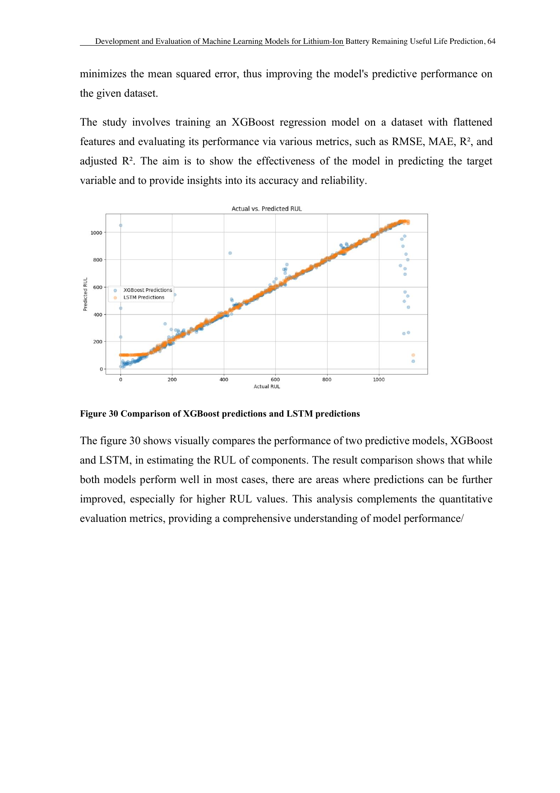
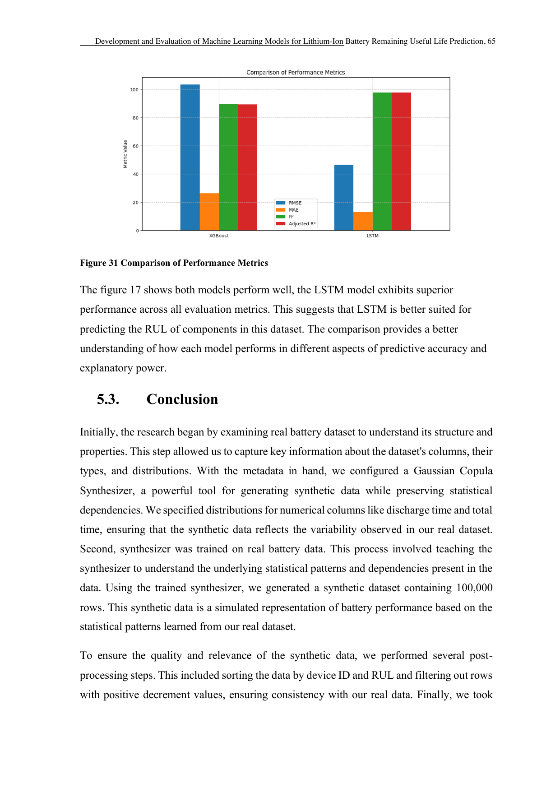

# Development and Evaluation of Machine Learning Models for Lithium-Ion Battery Remaining Useful Life Prediction

Bachelor's thesis by **Nayeem Faisal**, submitted at Technische Hochschule Augsburg on 27 October 2026 under the supervision of Prof. Dr. Fiorentino Valerio Conte.

## Research focus

This thesis investigates remaining useful life (RUL) prediction for lithium-ion batteries. The work combines:

- inspection and preprocessing of a real battery benchmark dataset;
- Gaussian Copula-based synthetic data generation;
- a generated dataset of 100,000 rows;
- correlation analysis and validation against the real data;
- exploratory data analysis and feature engineering; and
- LSTM and XGBoost regression, including model comparison.

The final study reports that LSTM performed better across the evaluated metrics for the dataset used in the thesis.

## Principal findings

- Cycle Index and RUL had a −0.999 correlation in both the real and synthetic correlation matrices, showing that the synthetic data retained the central degradation direction.
- The Frobenius norm between the matrices was 1.321, and neither matrix contained missing values.
- The synthetic dataset preserved important relationships but was not an exact copy: Discharge Time and RUL changed from 0.012 in the real data to 0.236 in the synthetic data.
- Both forecasting models performed well in most cases; LSTM produced the stronger result across the evaluated metrics for this dataset.
- The model comparison identified room for improvement at higher RUL values.

## Research achievements

The work characterised the real benchmark data, trained a Gaussian Copula Synthesizer, generated 100,000 synthetic rows, added device-aware integrity controls, compared real and synthetic correlation structures, and evaluated tuned XGBoost and LSTM forecasting approaches.

## Thesis website

The repository includes an interactive, chapter-based thesis companion in the site directory. It provides the complete 86-page thesis PDF, a searchable chapter index, the documented research workflow, selected findings, and author and citation information.

## Run locally

The repository now includes a VS Code workspace, repeatable tasks, the official THA LaTeX template files, and the supplied Exposé form.

### VS Code

1. Open `thesis-nayeem-faisal.code-workspace` in Visual Studio Code.
2. Choose **Terminal → Run Task → Setup local workspace** once.
3. Choose **Terminal → Run Task → Run thesis website**.
4. Open http://localhost:3000/thesis.

### Terminal

From the repository root:

    ./scripts/setup-local.sh
    ./scripts/run-site.sh

Open http://localhost:3000/thesis.

### THA LaTeX workspace preview

The LaTeX workspace is intentionally a template preview, not a rewritten version of the submitted thesis. Start Docker Desktop, then run:

    ./scripts/build-thesis-docker.sh

The generated preview is `academic-source/tha-template/Nayeem-Faisal-THA-Workspace.pdf`. The final submitted thesis PDF on the website remains the authoritative academic document.

## Verify

From the site directory:

    npm test

Or run **Verify website** from VS Code.

## Academic source material

- `academic-source/tha-template` contains the official THA LaTeX template components and a safe build preview configured with the known thesis metadata.
- `academic-source/expose/Vorlage Expose.docx` preserves the supplied blank Exposé template unchanged.
- Unknown private fields use explicit non-public placeholders; no personal data was invented.

## Authorship

The thesis research, wording, figures, tables, analysis, and conclusions are Nayeem Faisal's original academic work. The PDF is the authoritative source. The website is a navigable companion and does not replace the submitted paper.
